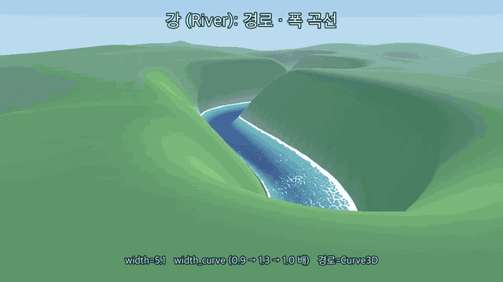
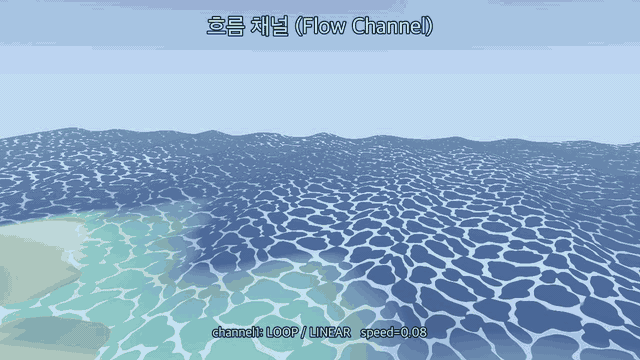
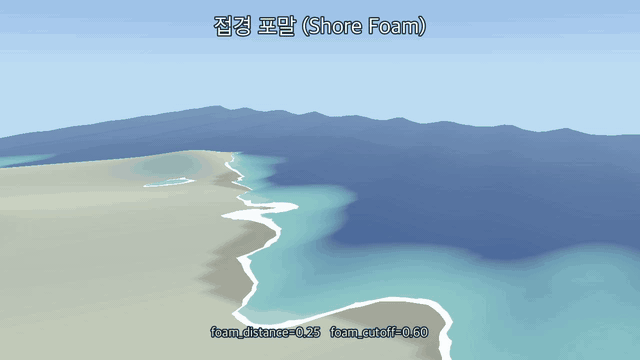
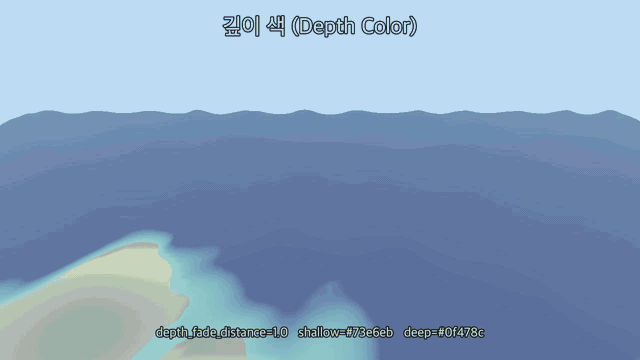
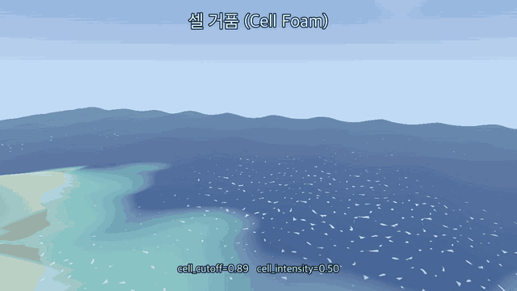
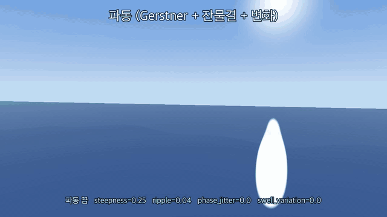
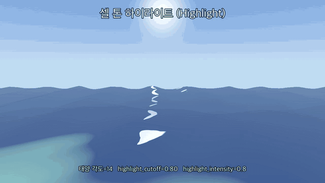
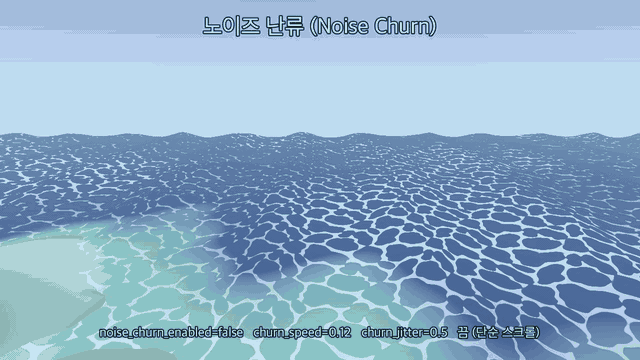
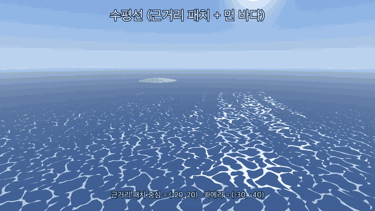

# CAT Ocean Flow

필요: `cat_core >= 1.0.0` · Godot 4.7+ · GDScript



기능별 시연 영상과 사용법: **[기능 소개 페이지](https://zzamjak-cloud.github.io/Godot_Addon/cat_ocean_flow/)**

Unity URP용 OceanFlow 패키지를 Godot으로 옮긴 카툰 스타일 3D 물 애드온입니다.
바다와 강을 같은 셰이더로 그리며, 접경 포말·깊이 색·셀 거품·노이즈 난류·Gerstner 파도·셀 톤 하이라이트·UV 흐름을 제공합니다.

## 설치

`addons/cat_core`, `addons/cat_ocean_flow` 폴더를 프로젝트의 `addons/`에 복사합니다. 설치 도구를 쓰는 방법은 [루트 README](../../README.md#설치)를 보세요.
런타임 노드는 `class_name`으로 등록되므로 플러그인을 켜지 않아도 동작합니다. 플러그인을 켜면 도구 메뉴에 세트 생성 항목이 생깁니다.

## 빠른 시작

에디터: **프로젝트 > 도구 > CAT Ocean Flow: 바다 세트 만들기**(수평선이 보이는 큰 바다) 또는 **강 세트 만들기**를 누르면 편집 중인 씬 루트에 세트가 추가됩니다(Ctrl+Z로 되돌림).
호수처럼 한 장으로 충분한 물은 씬에 `CatOceanFlowSurface`를 추가하고 `형상` 그룹에서 크기·분할 수를 정합니다.
물 아래에 지형(불투명 메쉬)이 있어야 포말과 깊이 색이 보입니다.

```gdscript
var sea := CatOceanFlowSurface.new()
sea.size_x = 60.0
sea.size_z = 60.0
sea.subdiv_x = 96
sea.subdiv_z = 96
sea.foam_distance = 0.8
sea.channel0.speed = 0.1          # 포말 노이즈 흐름
add_child(sea)

var river := CatOceanFlowRiver.new()   # 강 전용 파동 + 기본 S자 경로로 시작
river.width = 6.0
river.curve.add_point(Vector3(0, 0, 30), Vector3(0, 0, -4), Vector3(0, 0, 4))
add_child(river)

add_child(CatOceanFlowSurface.create_ocean_set())   # 근거리 + 먼 바다 세트
```

## 노드 구성

| 노드/리소스 | 역할 | Unity 원본 |
|---|---|---|
| `CatOceanFlowSurface` | 바다·호수 (XZ 그리드, 구멍, 카메라 추적, 먼 바다 동기화) | `OceanFlowSurface` |
| `CatOceanFlowRiver` | 강·하천 (Curve3D 경로 리본, 다음 강 사슬 동기화) | `OceanFlowRiver` + `OceanFlowPath` |
| `CatOceanFlowBase` | 둘의 공통 베이스(추상). `MeshInstance3D` 상속 | `OceanFlowBase` |
| `CatFlowChannel` | UV 레이어 하나의 흐름 리소스 | `FlowChannel` |

노드는 `ArrayMesh`(위치·UV만)와 `ShaderMaterial`을 스스로 만들어 `mesh`·`material_override`에 넣습니다. 이 둘은 씬 파일에 저장하지 않습니다.
그림자 투사와 GI는 끕니다. `extra_cull_margin`에는 파도 진폭 합을 넣어 화면 가장자리 컬링 팝핑을 막습니다.

## 인스펙터 구성

셰이더가 값을 쓰는 단위대로 그룹을 나눴습니다. 그룹의 on/off 토글을 끄면 그 그룹의 나머지 항목이 잠기고(읽기 전용), 동기화로 덮어써지는 항목도 받는 쪽에서 잠깁니다.
값을 바꾸면 다음 프레임에 한 번만 메쉬·머티리얼을 갱신합니다(dirty 플래그).

| 그룹 | 내용 |
|---|---|
| 형상 | 크기·분할 수·UV 타일링·구멍·카메라 추적·파도 가장자리 페이드 (바다) / 경로·폭·폭 곡선·샘플 수·v 밀도·시작 v (강) |
| 물 색 | `shallow_color`·`deep_color`, 알파, `depth_fade_distance` |
| 접경 포말 | `shore_foam_enabled`, 색·두께(`foam_distance`)·경계·부드러움·노이즈 세기·알파·거리 페이드 + **포말 노이즈 흐름 `channel0`** |
| 수면 노이즈 | `noise_texture` + **수면 노이즈 흐름 `channel1`** + 난류(`noise_churn_enabled` …) + 셀 거품(`cell_foam_enabled` …) |
| 파동 | `wave_enabled`, Gerstner 파 `wave_a`·`wave_b`(방향 xy, 가파름 z, 파장 w), 잔물결 `ripple`(진폭 x, 주파수 y, 속도 z) |
| 하이라이트 | `highlight_enabled`, 색·집중도·경계·세기, `main_light` |
| 시간 | `use_unscaled_time` |
| 먼 바다 동기화 / 다음 강 이어붙임 | `far_surface` / `next_river` |

경고(가파름 합 > 1, 스케일 ≠ 1, 정점 수 > 20,000, 파장 < 정점 간격 × 4, 구멍 ≥ 크기, 이음매 폭·위치 불일치 등)는 씬 트리의 노드 경고 아이콘으로 표시됩니다.

## 흐름 (CatFlowChannel)



채널 하나가 노이즈 UV 레이어 하나에 대응합니다. 채널 0은 접경 포말, 채널 1은 수면 셀 거품을 흘립니다.

| 속성 | 설명 |
|---|---|
| `mode` | `LOOP`: 한 방향으로 무한히 흐름(`speed` = 초당 UV 이동량) / `PING_PONG`: `range` 폭을 왕복(`speed` = 1왕복 초) |
| `direction` | 진행 방향(정규화되므로 길이 무시) |
| `ease` | `CatEase.Type`(1~31) 또는 `CatFlowChannel.EASE_CUSTOM`(32) |
| `custom_curve` | `EASE_CUSTOM`일 때 쓰는 `Curve`(0~1). 비어 있으면 선형 |
| `tiling` | 레이어 UV 타일링 (기본: 채널 0 = 4, 채널 1 = 7) |

`CatFlowChannel.evaluate(channel, time) -> Vector2`는 원본 `FlowChannel.Evaluate`와 같은 식입니다. Loop에서는 이징이 사이클 내부에만 걸려 사이클 경계에서 위치가 튀지 않습니다. Back/Elastic은 PingPong에서 `range`를 넘습니다(의도된 동작).
채널과 곡선은 `resource_local_to_scene` + 복제 시 항상 복사(`PROPERTY_USAGE_ALWAYS_DUPLICATE`)라서 노드를 복제(Ctrl+D)해도 공유되지 않습니다.

## 셰이더 기능

  
 

| 토글 | define | 내용 |
|---|---|---|
| `wave_enabled` | `WAVE_ON` | 버텍스 Gerstner 파 2개 + 잔물결, 해석적 법선 |
| `shore_foam_enabled` | `FOAM_SHORE` | 씬 깊이와 수면 깊이 차로 얕은 곳에 흰 물결 |
| `cell_foam_enabled` | `CELL_FOAM` | 흐르는 노이즈를 단계화한 카툰 거품 |
| `noise_churn_enabled` | `NOISE_CHURN` | 노이즈를 반주기 엇갈린 두 위상으로 교차 페이드해 무늬가 태어나고 사라짐 |
| `highlight_enabled` | `SPECULAR` | 메인 라이트 방향 기반 셀 톤 반짝임 |

본체는 `shaders/cat_ocean_flow.gdshaderinc` 하나입니다. 켠 기능 조합(비트마스크 32가지)마다 `shader_type spatial;` + `#define …` + `#include`로 `Shader`를 코드로 만들고, 정적 캐시로 같은 조합을 쓰는 모든 물이 공유합니다(`CatOceanFlowBase.get_variant_shader(mask)`). 꺼진 기능은 셰이더에서 아예 빠집니다.

- `render_mode unshaded, blend_mix, depth_draw_never, cull_back, world_vertex_coords` — 수면이 깊이를 쓰지 않아야 자기 자신이 깊이 텍스처에 들어가지 않습니다.
- 깊이: `hint_depth_texture`를 `INV_PROJECTION_MATRIX`로 선형 뷰 깊이로 바꿉니다. Forward+/Mobile은 `vec3(SCREEN_UV * 2.0 - 1.0, depth)`, Compatibility는 `vec3(SCREEN_UV, depth) * 2.0 - 1.0`(내장 `CURRENT_RENDERER` define으로 분기). 수면 깊이는 `-VERTEX.z`.
- 하이라이트 빛: `main_light`가 비어 있으면 씬에서 처음 찾은 보이는 `DirectionalLight3D`를 캐시해 씁니다(값이 바뀔 때만 다시 찾음). 빛 방향(`global_basis.z`)과 `light_color × light_energy`를 uniform으로 넘깁니다.
- 안개: `unshaded`여도 Godot 안개가 적용됩니다. 배경이 단색이면 바다 끝이 직선으로 잘리므로 배경색과 같은 안개를 켜세요.
- 노이즈 텍스처는 선형 데이터로 반복 샘플링합니다(`filter_linear_mipmap, repeat_enable`, `source_color` 없음). 직접 넣는 텍스처는 R 채널을 쓰고, 임포트에서 밉맵을 켜세요.

## 노이즈 난류



노이즈를 UV 오프셋만으로 흘리면 그물망 무늬가 통째로 미끄러집니다. 난류는 반주기 엇갈린 두 위상 A·B로 샘플해 교차 페이드하며, 각 위상은 사이클마다 다른 위치·회전으로 다시 태어납니다. 위상의 사이클 인덱스가 바뀌는 순간 그 위상의 가중치가 정확히 0이라 전환에서 튀지 않습니다.

| 속성 | 기본 | 내용 |
|---|---|---|
| `churn_speed` | 0.12 | 초당 재배치 사이클 수 |
| `churn_jitter` | 0.5 | 사이클마다 옮겨 앉는 거리(UV) |
| `churn_warp` | 0.06 | sin/cos로 UV를 비트는 양 |
| `churn_rotation` | 0.6 | 사이클마다 돌아가는 각도 폭(라디안) |

위상 인덱스·해시·회전은 프레임 상수라 GDScript가 계산해 uniform 5개로 올립니다(`compute_churn_phase()`, 채널 1은 0.37 사이클 어긋남). 셋을 모두 0으로 두면 단순 스크롤과 같습니다.

## 큰 바다 구성 (카메라 추적 패치 + 구멍)



균일 그리드 하나로 큰 바다를 덮을 수 없으므로 두 장을 씁니다. **바다 세트 만들기**가 만드는 구성:

| 역할 | 설정 |
|---|---|
| `OceanNear` | 80 × 80 m, 분할 80(정점 간격 1 m), `follow_camera` 켬, `wave_edge_fade` 0.15 |
| `OceanFar` | 1000 × 1000 m, 분할 8, 파도·하이라이트 끔, `far_surface`로 연결됨 |

추적 카메라는 비워 두면 실행 중 뷰포트의 현재 카메라(`get_viewport().get_camera_3d()`)를 씁니다. 에디터에서는 추적하지 않습니다.
기본값(`follow_look_at`)은 카메라 위치가 아니라 **카메라 중심 시선이 수면과 만나는 점**을 따라갑니다. 위치는 스냅 간격으로 양자화되고, 움직인 만큼 UV를 되돌려 노이즈가 월드에 고정됩니다.

### 먼 바다 동기화

근거리 패치의 `far_surface`에 먼 바다를 연결하면 **근거리 패치만 조정하면 먼 바다가 따라옵니다.**

| 항목 | 동작 |
|---|---|
| 색·포말·노이즈·채널·난류·셀 거품·파동·하이라이트 값, 시간 | 그대로 복사 |
| `uv_tiling` | 두 바다 크기 비율만큼 커짐(무늬가 이음매에서 이어짐) |
| `hole_size` | 근거리 패치 크기와 같아짐 |
| 카메라 추적(대상·시선 교차점·스냅) | 근거리 패치와 똑같이 강제 |
| 기능 on/off 토글 | **동기화하지 않음** |
| 크기·분할 수·`wave_edge_fade` | 먼 바다에서 직접 정함 |

동기화는 값이 바뀐 다음 프레임에 한 번만 돌아 매 프레임 비용이 없습니다. 먼 바다의 크기를 바꿔도 타일링과 구멍이 다시 계산됩니다.

## 긴 강 구성 (이어 붙이기)


`length_samples` 상한이 512라 긴 강은 여러 `CatOceanFlowRiver`로 나눠 이어 붙입니다. **강 세트 만들기**는 앞 구간의 경로 끝점에 뒤 구간을 놓고 그 진행 방향으로 돌려 연결합니다(`create_river_set()`).

### 경로 편집

강의 `curve`(Curve3D)는 강 노드의 로컬 좌표이며, 점의 in/out 핸들은 원본 handleIn/handleOut과 같은 상대 오프셋입니다.
에디터에서 강을 씬에 두면 같은 `curve`를 공유하는 자식 `Path3D`(`EditPath`)가 생깁니다. **`EditPath`를 선택해 Godot의 경로 기즈모로 점과 핸들을 편집하면 물길이 바로 따라옵니다.** `EditPath`의 위치·회전은 무시되고 항상 강과 같은 자리로 되돌려집니다. 런타임에는 필요 없으므로 지워도 됩니다.

### 다음 강 동기화

앞 강의 `next_river`에 뒤 구간을 연결하면 **앞 구간만 조정하면 뒤 구간이 따라옵니다.**

| 항목 | 동작 |
|---|---|
| 외형 값, 시간 | 그대로 복사 |
| `uv_start_v` | 앞 강의 `uv_end_v`로 자동 설정 → 이음매에서 무늬가 이어짐 |
| `uv_length_scale`, `width`, `width_curve` | 그대로 복사(곡선은 복제) |
| 기능 on/off 토글 / 경로·`length_samples`·`width_segments` | 동기화하지 않음 / 뒤 구간에서 직접 정함 |

시작 v는 앞에서 뒤로 누적되므로 A→B→C에서 A의 경로가 바뀌면 C의 시작 v까지 다시 계산됩니다. 순환 연결(A→B→A)은 경고를 내고 멈춥니다.
새로 만든 강은 강 전용 파동 기본값(진폭 합 약 0.03 m, `apply_river_wave_defaults()`)과 기본 S자 경로(`create_default_path()`)로 시작합니다.

## 공개 API

| 멤버 | 원본 |
|---|---|
| `rebuild_mesh()`, `mark_properties_dirty()` | `RebuildMesh()`, `MarkPropertiesDirty()` |
| `advance_preview_time(dt)`, `reset_preview_time()`, `externally_driven`, `flow_time` | `AdvancePreviewTime`, `ResetPreviewTime`, `ExternallyDriven` |
| `copy_synced_appearance_to(target)`, `get_bounds_padding()`, `shortest_wavelength`, `get_feature_mask()` | `CopySyncedAppearanceTo`, `BoundsPadding`, `ShortestWavelength` |
| Surface: `sync_far_surface()`, `has_far_surface`, `synced_far_uv_tiling`, `estimated_vertex_count`, `vertex_spacing`, `effective_snap`, `build_grid_arrays()`, `create_ocean_set()` | `SyncFarSurface` …, 메뉴 `Ocean Set Make` |
| River: `sync_next_river()`, `apply_river_wave_defaults()`, `create_default_path()`, `get_path_end() -> {ok, position, direction}`, `path_length`, `uv_end_v`, `start_width`, `end_width`, `estimated_vertex_count`, `resample()`, `measure_length()`, `create_river_set()` | `SyncNextRiver`, `ApplyRiverWaveDefaults`, `CreateDefaultPath`, `TryGetPathEnd` …, 메뉴 `River Set Make` |

## 성능

- 프레임당 CPU: 노드 하나당 이징 2회 + `set_shader_parameter` 1회(오프셋), 난류가 켜져 있으면 5회, 하이라이트가 켜져 있으면 빛이 바뀐 프레임에만 2회. 메쉬는 파라미터가 바뀔 때만 다시 만들고 정점 움직임은 GPU가 맡습니다.
- 흐름 오프셋은 업로드 전 `[0,1)`로 감아 장시간 실행해도 정밀도가 무너지지 않습니다.
- 깊이 텍스처 페치는 항상 1회, 노이즈 페치는 포말·셀 거품 각 1회(난류를 켜면 각 2회).
- 모바일에서는 물 하나당 정점 20,000개 이하를 권장합니다.

## 주의 사항

- Gerstner 파 A·B의 가파름 합이 1을 넘으면 수면이 접힙니다. 파장은 정점 간격 × 4 이상이어야 파도로 보입니다.
- **노드 스케일은 1로 둡니다.** 파도 변위는 월드 단위라 스케일 < 1이면 컬링 팝핑이 생깁니다.
- **포말 띠 두께는 시선 각도에 의존합니다.** 수중 두께를 시선 방향으로 재므로, 물가 경사가 시선보다 급하면 포말이 사라집니다.
- 먼 물가는 깊이 분해능이 떨어져 띠가 깜빡입니다. `foam_fade_start`/`foam_fade_end`로 150~300 m부터 지우세요.
- `cull_back`이라 수면 아래에서는 보이지 않습니다. 깊이를 쓰지 않으므로 뒤에 오는 투명체와는 거리 정렬로만 겹칩니다.
- 파도는 셰이더 `TIME`을 써서 `Engine.time_scale = 0`이어도 움직입니다. 흐름과 난류는 노드 시간(`use_unscaled_time`)을 따릅니다.
- 강의 강 전용 파동 기본값은 생성자에서 넣습니다. 강에서 파동 값을 바다 기본값과 똑같이 맞추면 씬에 저장되지 않아 다시 열 때 강 기본값으로 돌아갑니다.

## 데모·테스트

| 파일 | 내용 |
|---|---|
| `demo/cat_ocean_flow/ocean_demo.tscn` | 경사진 모래 해변 + 바다(포말·깊이 색·셀 거품·하이라이트) |
| `demo/cat_ocean_flow/river_demo.tscn` | 골짜기를 따라 흐르는 강(폭 곡선, `EditPath`) |
| `demo/cat_ocean_flow/horizon_demo.tscn` | 근거리 추적 패치 + 먼 바다 세트와 섬 |
| `tests/cat_ocean_flow/test_ocean_flow.gd` | 헤드리스 로직 검증(흐름·난류·그리드·경로·리본·동기화·복제·저장) |
| `tests/cat_ocean_flow/check_shader_variants.gd` | 창 모드: 32개 셰이더 조합 컴파일 확인 |
| `tests/cat_ocean_flow/capture_3d.gd` | 창 모드: 3D 씬 PNG 캡처 |

## 샘플 영상

`docs/media/cat_ocean_flow/`에 기능별 MP4와 GIF가 있습니다. 다시 만들려면 `tools/record_cat_ocean_flow.sh [씬이름]`을 실행합니다(렌더러는 Forward+). 씬은 `demo/cat_ocean_flow/showcase/`에 있습니다.

## 원본(Unity)과의 차이

- **셰이더 변형**: `multi_compile_local` 키워드 대신 기능 조합별로 코드에서 생성한 `Shader`(#define + #include)를 씁니다.
- **깊이**: `_CameraDepthTexture` + `screenPos.w` 대신 `INV_PROJECTION_MATRIX`로 선형 깊이를 구합니다. 그래서 **직교(Orthographic) 카메라에서도 포말과 깊이 색이 동작합니다**(원본은 원근 카메라 전용). Depth Texture 설정 확인·경고는 필요 없습니다(4.7 렌더러 모두 지원).
- **메인 라이트**: URP `_MainLight` 대신 `main_light` 또는 씬의 첫 `DirectionalLight3D`를 uniform으로 넘깁니다. 물 자체는 `unshaded`입니다.
- **60초 미리보기 없음**: `@tool` 노드가 에디터에서 바로 흐르므로 미리보기 버튼이 필요 없습니다. `advance_preview_time()`/`externally_driven`은 외부에서 시간을 직접 밀고 싶을 때를 위해 남겼습니다.
- **강 경로 편집**: 원본의 전용 씬뷰 에디터(정점 클릭·핸들 색 구분·꺾임 `IsBroken`) 대신 Godot `Path3D` 기즈모를 씁니다. 핸들 연결/끊기는 Godot 기즈모 규칙을 따릅니다.
- **이징**: 원본 `OceanFlowEaseType`(0부터, Custom = 31) 대신 `CatEase.Type`(1부터) + `EASE_CUSTOM = 32`. 수식은 같고 t를 [0,1]로 자르는 규칙도 같습니다. `AnimationCurve` → `Curve`.
- **카메라 추적 UV 보정**: 메쉬 UV 원점(모서리)만큼 반 크기 보정을 더했습니다. 원본은 두 바다의 반 크기 차가 노이즈 주기의 정수배가 아니면(예: 세트 기본값 80 m ↔ 1000 m의 셀 거품 채널) 이음매에서 무늬가 어긋났습니다.
- **카메라 추적 시점**: Unity `LateUpdate` 대신 `process_priority = 100`인 `_process`에서 따라갑니다. 카메라를 `_physics_process`로 움직이면 한 프레임 늦을 수 있습니다.
- **수치**: GDScript 실수는 64비트라 난류 해시(`sin(…) × 43758.5453`의 소수부)가 Unity float와 비트 단위로 같지는 않습니다. 성질(결정적, [0,1), 64 주기, 전환 시 가중치 0)은 같습니다.
- **동기화 Undo**: 원본은 동기화 값 밀어넣기를 Undo에 기록했지만, 여기서는 동기화가 앞 노드 값에서 항상 다시 유도되므로 기록하지 않습니다.
- **인스펙터**: 접힘 상태 저장(EditorPrefs)·채널 속도 곡선 그래프·"구동 중" 배지는 없습니다. 잠금은 읽기 전용 표시로, 경고는 노드 경고로 대신합니다.
- **16/32비트 인덱스 전환 경고 없음**: Godot `ArrayMesh`가 인덱스 크기를 알아서 고릅니다.

## 라이선스

MIT — [LICENSE](LICENSE). 원본 Unity 패키지(GPL-3.0)와 저작권자가 같으며, 이 Godot 이식판은 MIT로 배포합니다.
