# CAT Text FX

필요: `cat_core >= 1.0.0` · Godot 4.7+ · GDScript

Unity용 [TMPEffect](https://github.com/zzamjak-cloud/TMPEffect) 패키지를 Godot으로 옮긴 텍스트 연출 애드온입니다.
`Label`을 대신하는 `CatText` 노드에 자식 노드를 붙여 외곽선·그림자·안쪽 면(Second Face)·글로우·곡선 배치·글자별 애니메이션을 적용합니다.
`CatMaskFlow`(전광판 흐름)와 `CatLayoutLimiter`(최대 크기 제한)는 일반 `Label`에도 쓸 수 있습니다.

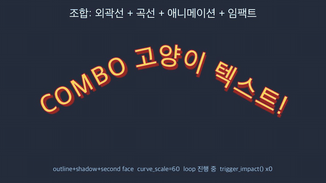

## 설치

`addons/cat_core`, `addons/cat_text_fx` 폴더를 프로젝트의 `addons/`에 복사합니다. 설치 도구를 쓰는 방법은 [루트 README](../../README.md#설치)를 보세요.
런타임 노드는 `class_name`으로 등록되므로 플러그인을 켜지 않아도 동작합니다.

## 빠른 시작

에디터: 씬에 `CatText`를 추가하고, 그 자식으로 `CatTextOutline`, `CatTextAnimation` 같은 효과 노드를 추가한 뒤 인스펙터에서 값을 조절합니다.

```gdscript
var label := CatText.new()
label.text = "고양이 Title"
label.font_size = 48
add_child(label)

var outline := CatTextOutline.new()
outline.set_outline(Color.BLACK, 0.3)
label.add_child(outline)

var anim := CatTextAnimation.new()
anim.apply_preset(CatTextAnimationPreset.create_bounce_appear())
label.add_child(anim)          # play_on_ready = true 이면 자동 재생
anim.trigger_impact()          # 재생 중 단발 강조
```

## 노드 구성

| 노드 | 붙이는 위치 | 역할 | Unity 원본 |
|---|---|---|---|
| `CatText` | 어디든(`Control`) | 글자를 직접 그리는 Label 대체 노드 | `TextMeshProUGUI` |
| `CatTextOutline` | `CatText` 자식 | 외곽선·드롭섀도·그림자·안쪽 면 | `TMPOutlineEffect` |
| `CatTextGlow` | `CatText` 자식 | 방사형 글로우 + Inner Glow | `TMPOutGlow` |
| `CatTextCurve` | `CatText` 자식 | 곡선 위에 글자 배치 | `TMPCurve` |
| `CatTextAnimation` | `CatText` 자식 | 글자별 Appear → Loop → Disappear + Impact | `TMPAnimation` |
| `CatMaskFlow` | 텍스트 노드의 부모 | 마스크 영역 안 전광판 흐름 | `TMPMaskFlow` |
| `CatLayoutLimiter` | `Label`/`CatText` 자식 | 최대 너비·높이 도달 시 줄바꿈·고정 | `TMPLayoutLimiter` |
| `CatTextStylePreset` | 리소스 `.tres` | Outline/Glow 설정 저장 | `TMPEffectPreset` |
| `CatTextAnimationPreset` | 리소스 `.tres` | 애니메이션 설정 저장 | `TMPAnimationPreset` |

그리는 순서(뒤 → 앞): 그림자 → 글로우 번짐 → Underlay(외곽선) → 본문(Face) → 안쪽 면 → Inner Glow.
글자별 변환은 애니메이션을 먼저, 곡선을 나중에 적용합니다(원본과 같음).

## CatText

Label과 이름이 같은 속성: `text`, `font`(비우면 테마), `font_size`(0이면 테마), `font_color`, `horizontal_alignment`, `vertical_alignment`, `autowrap_mode`, `line_spacing`, `uppercase`.
번역(`atr`)·테마 변경·크기 변경(autowrap)에 맞춰 다시 셰이핑합니다.

| 멤버 | 설명 |
|---|---|
| `signal reshaped` | 텍스트·폰트·줄바꿈이 바뀌어 글자 배치를 다시 계산한 직후 |
| `get_natural_size()` | 줄바꿈 없이 그렸을 때 크기 |
| `get_cluster_count()` / `get_cluster_rect(k)` / `is_cluster_visible(k)` | 글자(클러스터) 단위 정보 |
| `get_text_bounds()` | 보이는 글자 전체를 감싸는 사각형 |
| `get_display_text()` | 번역·대문자 변환이 끝난 실제 표시 문자열 |

직접 효과 노드를 만들 때: `CatTextModifier`를 상속하고 `fill_states(text) -> bool`로 글자 상태 배열을 넘깁니다. 넘긴 배열은 참조로 공유되므로 CatText 쪽에서 수정하지 않습니다.

## CatTextOutline

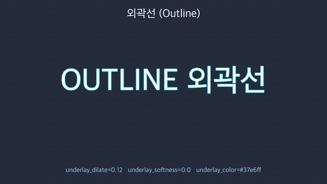 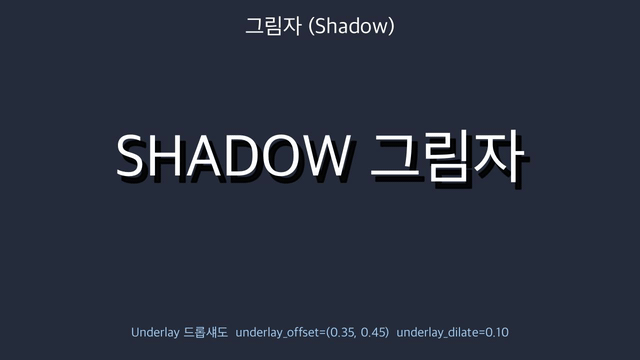 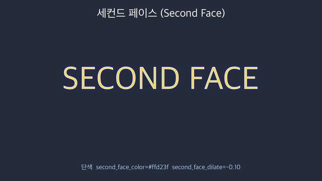

| 그룹 | 속성 | 범위 / 기본 |
|---|---|---|
| Underlay | `underlay_color`, `underlay_dilate`(두께), `underlay_offset_x/y`(드롭섀도), `underlay_softness` | dilate 0~1 / 0.15, offset -1~1, softness 0~1 |
| Face | `face_dilate`(본문 굵기) | 0~1 (음수는 0으로 처리) |
| Shadow | `enable_shadow`, `shadow_offset`(font_size 배율), `shadow_alpha` | (0.1, 0.1), 0.5 |
| Second Face | `enable_second_face`, `second_face_color`, `use_second_face_gradient` + 4색, `second_face_dilate`(-1~0), `second_face_offset_x/y` | |

메서드: `set_outline(color, width, softness=0)`, `set_drop_shadow(color, offset_x, offset_y, dilate=0.1)`, `set_outline_with_shadow(color, width, shadow_alpha, shadow_offset)`, `apply_preset(preset)`, `reset_effect()`.
인스펙터의 **새 프리셋으로 저장** 버튼은 현재 값을 `res://cat_text_presets/<노드이름>.tres`로 저장합니다.

## CatTextGlow

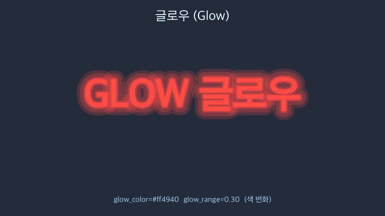

`glow_color`(RGBA), `glow_range`(0~1), `inner_glow_alpha`(0~1), `face_dilate`. 글로우가 있으면 본문 색의 RGB는 글로우 색을 따릅니다(알파는 `font_color` 유지, 원본과 같음).
메서드: `set_glow(color, range)`, `apply_preset(preset)`, `reset_effect()`.

## CatTextCurve

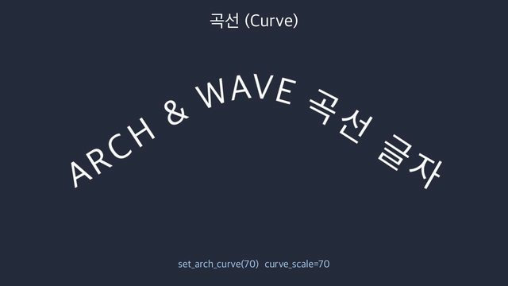

| 속성 | 설명 |
|---|---|
| `curve` | X = 텍스트 가로 위치(0~1), Y = 높이 비율(위쪽 +, -2~2) |
| `curve_scale` | 높이 픽셀(동적 보정이 켜져 있으면 기준 조건에서의 세기) |
| `preserve_vertical_center` | 글자 높이 평균을 0으로 맞춰 블록이 위로 밀리지 않게 |
| `rotate_along_curve`, `rotation_strength` | 곡선 기울기를 따라 글자 회전 |
| `enable_dynamic_curve_scale`, `reference_*` | 글자 수·폰트 크기·영역 크기에 비례해 곡선 세기 자동 보정 |

메서드: `set_arch_curve(height)`, `set_wave_curve(amplitude, frequency=1)`, `reset_curve()`, `refresh()`.
`curve`가 비어 있으면 평평하게(오프셋 0) 둡니다. 새로 추가한 노드는 인스펙터에서 `curve`를 지정하거나 코드에서 `set_arch_curve()`를 호출해야 휩니다.

## CatTextAnimation

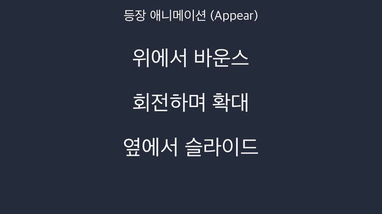 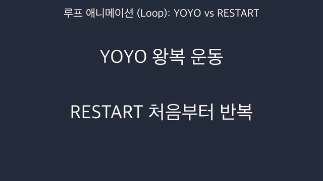 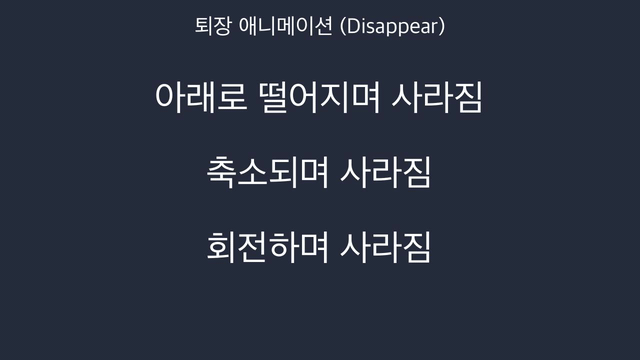
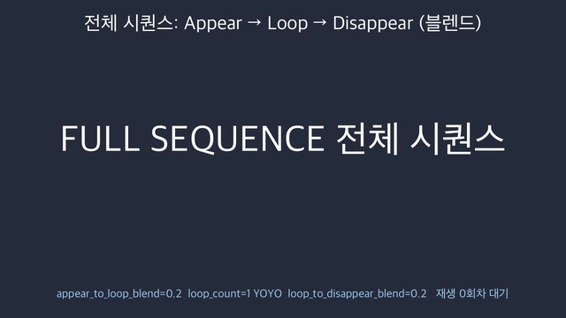 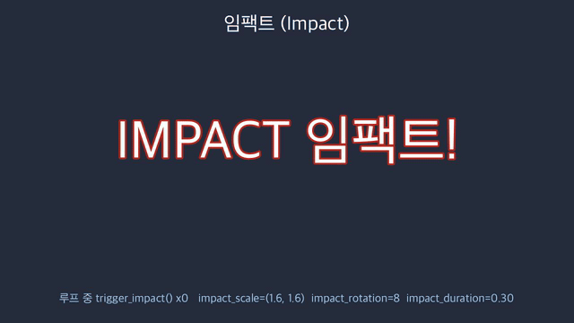 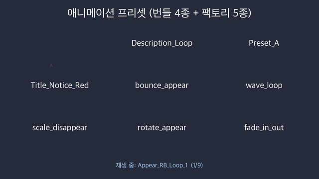

글자 i의 시작 시각 = `initial_delay + i * character_delay` (i는 공백을 포함한 원문 인덱스).

| 그룹 | 주요 속성 |
|---|---|
| Timing | `character_delay`, `initial_delay`, `pivot`(정규화. (0.5,0)=가로 중앙·베이스라인, (0.5,1)=위쪽) |
| Appear | `enable_appear`, `appear_relative`, `appear_position/scale/rotation/alpha`, `appear_duration`, `appear_ease` 또는 `appear_curve`, `appear_to_loop_blend`, 위치 베지어(`appear_use_position_curve`, `..._offset`) |
| Loop | `enable_loop`, `loop_position/scale/rotation`, `loop_duration`(한 방향), `loop_count`(-1=무한), `loop_type`(YOYO/RESTART), `loop_to_disappear_blend` |
| Disappear | `enable_disappear`, `disappear_position/scale/rotation/alpha`, `disappear_duration`, `disappear_ease` |
| Impact | `enable_impact`, `impact_scale`(곱), `impact_position`/`impact_rotation`(더하기), `impact_duration`, `impact_character_delay` |

- 이징은 `*_ease`(`CatEase.Type` 31종)를 쓰고, `*_curve`에 `Curve`를 넣으면 그것을 우선합니다.
- 메서드: `play()`, `stop()`, `pause()`, `resume()`, `restart()`, `trigger_impact()`, `apply_preset(preset)`, `advance(dt)`.
- 상태: `is_playing`, `is_impact_playing`. 신호: `animation_finished`, `impact_finished`.
- 에디터 인스펙터의 **미리보기 재생 / 정지 / Impact** 버튼으로 실행하지 않고 확인할 수 있습니다.
- `loop_count = -1`(무한)이면 Disappear는 무시됩니다.
- 텍스트가 바뀌면 다시 재생합니다. 같은 문자열로 다시 배치될 때(리사이즈·테마·같은 번역)는 다시 재생하지 않고, 일시정지 중이면 일시정지를 유지합니다.
- 빈 텍스트나 공백만 있으면 `play()` 후 곧바로 `animation_finished`가 발생합니다.
- `trigger_impact()`는 호출 시점의 Impact 설정을 사용합니다.

## CatMaskFlow

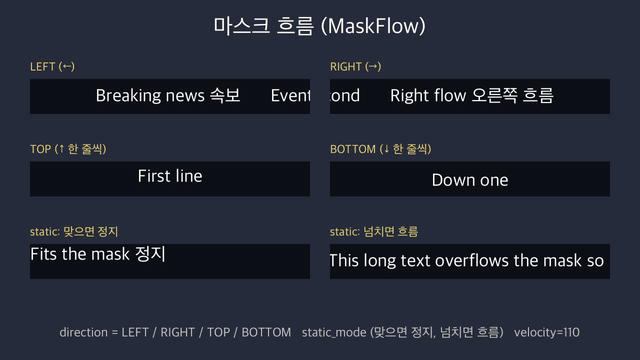

`clip_contents`가 켜진 컨테이너입니다. **첫 번째 자식**(`text` 속성이 있는 `Label`·`CatText` 등)을 템플릿으로 복제해 흐르게 합니다. 복제본은 내부 노드라 씬에 저장되지 않으며, 에디터에서는 템플릿만 보입니다.

| 속성 | 설명 |
|---|---|
| `direction` | LEFT/RIGHT = 이어지는 띠(마퀴), TOP/BOTTOM = 한 줄씩 교체 |
| `velocity`, `gap`, `interval`(TOP/BOTTOM 전용), `delay` | 이동 속도(px/s)·간격·교체 후 대기·시작 대기 |
| `static_mode` | 텍스트가 영역에 들어가면 흐르지 않고 정렬대로 표시, 넘칠 때만 흐름 |
| `text_entries` | 순서대로 보여줄 문자열(번역 키 가능). 비어 있으면 템플릿 텍스트 |
| `max_sequence_copy_count` | 마퀴 복제 수 상한(0 = 무제한) |

흐름이 멈춰 있어도 템플릿 텍스트·번역 변경을 반영합니다. TOP/BOTTOM 교체 때 도착한 텍스트의 애니메이션은 다시 시작하지 않고, 숨긴 템플릿의 애니메이션은 멈춥니다. `use_unscaled_time`은 `Engine.time_scale`만 무시합니다(일시정지는 따름).
메서드: `play()`, `stop()`, `restart()`, `refresh()`(템플릿 폰트·크기 변경 후 호출), `set_text_entries(entries, restart_flow=false)`, `set_text_resolver(callable)`. 신호: `turn_changed(index)`.

## CatLayoutLimiter

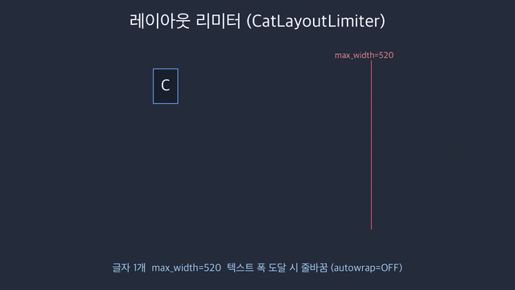

`Label`·`CatText`의 자식으로 붙입니다. 자연 너비가 `max_width` 이상이 되면 부모의 autowrap을 켜고 최소 너비를 `max_width`로 고정합니다. 미만이면 원래대로 되돌립니다. `max_height`에 도달하면 높이를 고정하고 잘라냅니다(Label은 `clip_text`). 노드를 지우면 원래 설정으로 돌아갑니다. 크기는 번역·대문자·`label_settings`를 반영해 잽니다. 씬 파일이 바뀌지 않도록 **에디터에서는 동작하지 않고 실행 중에만** 적용됩니다.

## 프리셋

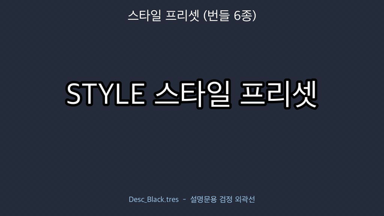

- 스타일(`presets/style/`): `Desc_Black`, `Desc_Black_Shadow`, `Title_Extrude_Brown`, `Title_Out1_Purple_Shadow`, `Title_Out2_Red_Shadow`, `Glow_Green`
- 애니메이션(`presets/animation/`): `Title_Notice_Red`, `Appear_RB_Loop_1`, `Preset_A`, `Description_Loop`
- 코드 팩토리: `CatTextStylePreset.create_simple_outline() / create_drop_shadow() / create_title()`, `CatTextAnimationPreset.create_bounce_appear() / create_wave_loop() / create_scale_disappear() / create_rotate_appear() / create_fade_in_out()`

원본 Unity 프리셋 값을 옮기면서 y 방향과 회전 방향의 부호를 바꿨습니다(Godot은 y가 아래쪽 +, 회전 + = 시계 방향).

## 샘플 영상

`docs/media/cat_text_fx/`에 기능별 MP4와 GIF가 있습니다. 다시 만들려면 `tools/record_showcase.sh [씬이름]`을 실행합니다. 씬은 `demo/cat_text_fx/showcase/`에 있습니다.

## 원본(Unity)과의 차이

**렌더링** — TMP의 SDF 셰이더가 없어 글자 테두리를 여러 번 그리는 방식으로 대신합니다.
- 두께 단위 환산(시각 보정값, `CatText` 상수): dilate 1.0 = 0.15em(`DILATE_EM`), underlay offset 1.0 = 0.25em, glow range 1.0 = 0.3em. 원본과 체감 두께가 다를 수 있습니다.
- 소프트니스는 진짜 블러가 아니라 최대 3겹의 반투명 테두리로 근사합니다(가장 안쪽 누적 알파 = 색 알파). 외곽선 두께는 1px 단위로 반올림합니다.
- Second Face를 켜면 클리핑용 오프스크린 버퍼를 쓰고, `self_modulate` 변화를 반영하려고 `_process`가 돕니다. 끄면 모든 효과를 노드 하나에 그려 `material`·`self_modulate`·`texture_filter`가 그대로 적용됩니다.
- 많은 글자에 큰 외곽선을 쓰면 MSDF로 임포트한 폰트를 권장합니다(외곽선 크기별 글리프 캐시가 필요 없음).
- 음수 `face_dilate`(본문 가늘게)는 지원하지 않습니다(0으로 처리). Outline과 Glow를 함께 쓰면 `face_dilate`는 둘 중 큰 값을 씁니다.
- Second Face 그라디언트는 글자마다가 아니라 텍스트 블록 전체 기준 4색 보간입니다. `second_face_dilate`가 -0.2 이하이면 48px 안팎에서 안쪽 면이 거의 사라집니다.
- 그림자 위치 = `shadow_offset` + underlay offset(원본 CPU 그림자가 Underlay까지 복제하는 것과 같게).
- Material 공유 캐시는 필요 없어 없습니다(그리기 명령 방식). Inner Face/Inner Glow 자식 오브젝트도 만들지 않고 한 노드 안에서 그립니다.
- 외곽선·글로우 크기를 매 프레임 바꾸면 폰트 글리프 캐시가 커집니다. 크기는 단계적으로만 바꾸세요.

**애니메이션**
- x/y축 회전(3D)은 없고 z 회전만 있습니다(Vector3 → Vector2 + float).
- 오버슈트: 원본은 Unity `Lerp`가 값을 잘라 OutBack·Elastic의 튀는 동작이 보이지 않았습니다. 기본값은 튀는 동작을 살리고, `clamp_overshoot = true`면 원본처럼 자릅니다.
- Appear만 있을 때 끝난 뒤 최종 상태를 확실히 적용합니다(원본은 마지막 프레임 값이 남음).
- 원본에 없던 신호 `animation_finished`, `impact_finished`를 추가했습니다.
- CanvasGroup을 쓰던 초기 깜빡임 방지는 재생 시작 즉시 Appear 시작 상태를 적용하는 것으로 대신합니다.
- 번들 프리셋 중 `AnimationCurve`를 쓰던 것은 가장 가까운 `CatEase`로 바꿨습니다.

**MaskFlow / LayoutLimiter**
- `TextEntry`(키 + 미리보기)는 문자열 배열 `text_entries`로 단순화했습니다. `Static` 속성 이름은 `static_mode`입니다.
- 정렬 판정은 템플릿의 `horizontal_alignment`/`vertical_alignment`를 씁니다.
- 템플릿의 폰트·크기를 런타임에 바꾸면 `refresh()`를 호출해야 합니다.
- TMP Auto Size(최대 폰트 기준 측정)는 대응하지 않습니다.

**정렬**: `HORIZONTAL_ALIGNMENT_FILL`(양쪽 맞춤)은 왼쪽 정렬로 처리합니다.

## 라이선스

MIT — [LICENSE](LICENSE)
